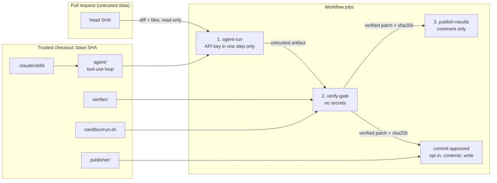

# Taskly with an AI unit-test agent

This repository adds a custom agent that analyzes a pull request, writes or
updates unit tests for the Taskly backend and frontend, and proves the tests
through a sandboxed verification gate before a human can commit them.

- Agent + skills: `.claude/agents/unit-test-agent.md`, `.claude/skills/`
- Runtime: `ai_test_agent/` (`agent`, `verifier`, `publisher`, `sandbox`,
  `selftests`)
- Workflows: `.github/workflows/unit-test-agent.yml` (PR) and
  `coverage-backfill.yml` (manual backfill)

**Provider and data flow.** The default provider is DeepSeek
(`deepseek-flash`, over its Anthropic-compatible Messages API) because that is
the path with recorded live runs; Anthropic (`claude-sonnet-5-5`) is opt-in
through `TASKLY_AGENT_PROVIDER=anthropic` and has no live run here. The default
sends the diff and the files the agent reads to a third-party API, so it is
external processing: use an approved provider with retention terms and never
point it at secrets or code you may not share (see Limitations).

## Architecture



`agent/definition.py` reads the agent file's frontmatter (name, model key, tool
allowlist) and body (system prompt); `agent/skills.py` keeps only a skill's name
and description in the prompt until `activate_skill` returns its body and
records the activation.

## Decisions

| Decision | Rationale | Trade-off |
| --- | --- | --- |
| Custom tool-use loop on the official `anthropic` SDK | Every call and token count is auditable; no framework hides the control flow | We own retries and message plumbing |
| Provider abstraction: DeepSeek by default, Anthropic opt-in | One SDK, one loop; the key, base URL, model and price table are selected in one place, and the default is the provider with live-run evidence | A second price table; DeepSeek peak rates set the budget |
| All tooling runs from the trusted base checkout | The PR cannot change the code that holds the key or makes decisions | Tooling changes need their own PR before a demo PR |
| Patch posted by default, commit opt-in via label | The patch is reviewable and a human decides what lands | A second action is required to commit |
| Per-stack baseline and per-stack revert | A broken backend baseline must not block a healthy frontend | More sandbox runs per PR |
| Differential fail-on-base signal | Shows whether the new tests actually exercise changed behavior | Evidence, not proof; new source files are `n/a` |
| Strict manifest schema + independent integrity rules | Model output is untrusted and the verifier does not share the agent's path logic | Some duplication between agent and verifier |
| Coverage backfill reuses the same gate | One definition of "verified" everywhere | Backfill is serial and slower |

## How to run

Prerequisites:

1. Repository secret `DEEPSEEK_API_KEY` (default provider) or
   `ANTHROPIC_API_KEY` with the repository variable
   `AGENT_PROVIDER=anthropic`.
2. Workflow permissions read-only, with "Allow GitHub Actions to create and
   approve pull requests" enabled.
3. Label `ai-tests:commit`.

Pull request flow: open, push to, reopen or label a PR. Add
`ai-tests:commit` only after reviewing the sticky comment; the label event
does not re-run the agent.

Backfill: Actions → Coverage backfill → Run workflow, choose `stack` and
`max_batches`. It updates `chore/ai-backfill-unit-tests` and opens or updates
a PR against the default branch.

Local run (same gate):

```sh
cd ai_test_agent
python3 -m venv .venv
.venv/bin/pip install -r requirements.lock
export TASKLY_AGENT_PROVIDER=deepseek   # default; anthropic to opt in
export DEEPSEEK_API_KEY=...             # ANTHROPIC_API_KEY to opt in
.venv/bin/python -m agent --mode pr \
  --repo ../pr --diff ../pr.diff --out ../artifacts \
  --skills-dir ../.claude/skills \
  --agent-definition ../.claude/agents/unit-test-agent.md \
  --sandbox-script sandbox/run.sh
# then the verifier command shown by `python -m verifier --help`
```

## Example run

Every row is a real workflow run on the DeepSeek default. One run's report and
trimmed trace are committed under `docs/evidence/` because artifacts expire.

| Run | Result | Cost |
| --- | --- | --- |
| [Backfill #10](https://github.com/CharlesSBL/taskly-app/actions/runs/39901769430) → [PR #10](https://github.com/CharlesSBL/taskly-app/pull/10), merged `dda5cd3` | Backend 42.42% → 47.88%, frontend 47.68% → 49.00%; 3 new test files, 18 turns | $0.0173 |
| [Demo #11](https://github.com/CharlesSBL/taskly-app/actions/runs/39927537759) → [PR #11](https://github.com/CharlesSBL/taskly-app/pull/11) | 7 decisions (2 create, 4 update, 1 skip), both stacks accepted, backend 47.88% → 51.69%, frontend 49.00% → 51.57%, fail-on-base hit for the 3 updated files, 20 turns, opt-in commit [`a3a6240`](https://github.com/CharlesSBL/taskly-app/commit/a3a6240) | $0.0275 |
| [Demo #12](https://github.com/CharlesSBL/taskly-app/actions/runs/39928204014) → [PR #12](https://github.com/CharlesSBL/taskly-app/pull/12) | Docs-only change: `nothing_to_test`, 0 turns, model `not-run` | $0.0000 |
| [Backfill #13](https://github.com/CharlesSBL/taskly-app/actions/runs/39929977475) → [PR #13](https://github.com/CharlesSBL/taskly-app/pull/13), merged `805befb` | Frontend 49.00% → 61.58% (+12.58) accepted; backend reverted because the generated tests failed | $0.0518 |
| [Backfill #14](https://github.com/CharlesSBL/taskly-app/actions/runs/39932704982) → [PR #14](https://github.com/CharlesSBL/taskly-app/pull/14), merged `75dce16` | Backend 47.88% → 98.79% (+50.91); six files, three created and three updated | $0.0354 |
| [Backfill #15](https://github.com/CharlesSBL/taskly-app/actions/runs/39933376858) → [PR #15](https://github.com/CharlesSBL/taskly-app/pull/15), merged `8d0d4d5` | Frontend 61.58% → 81.45% (+19.87) | $0.0582 |
| [Backfill #16](https://github.com/CharlesSBL/taskly-app/actions/runs/39934359334) → [PR #16](https://github.com/CharlesSBL/taskly-app/pull/16), closed unmerged | Backend 100%, frontend 96.68%, but three files failed `prettier --check`, which the gate did not run then: closed and re-verified after the fix | $0.0460 |
| [Backfill #17](https://github.com/CharlesSBL/taskly-app/actions/runs/39938721832) → [PR #17](https://github.com/CharlesSBL/taskly-app/pull/17), merged `4b55d7d` | Backend 98.79% → 100.00% (+1.21), frontend 81.45% → 92.71% (+11.26), accepted by the gate that now runs Prettier | $0.0376 |

Coverage on `main` is **100.00% backend and 92.71% frontend**, up from 42.42%
and 47.68%. The frontend gained 45 points across four runs for about $0.19
(roughly $0.004 per point); what remains is mostly error branches that need a
browser. Across the thirteen live runs, including two that produced no PR, the
total spend is **$0.47**, summed from each manifest's `cost_usd`.

## Assumptions

- The base revision is a git checkout with the PR's base commit available.
- The repository uses `main` by default.
- Backend tests run with `cwd=backend`; frontend tests with `cwd=frontend`.
- Prices for both providers were verified on 2026-10-23; DeepSeek budgets use
  the higher peak-hour rates.
- The app's lock file is not hash-pinned, so the sandbox uses binary wheels
  only; the tooling's own lock file is hash-pinned.

## Limitations

Four limitations matter most:

1. **`GITHUB_TOKEN` pushes do not trigger workflows.** The commit job's commit
   never runs `ci.yml`, so required checks are not re-evaluated. That is why
   commit is opt-in and the patch is the default; the verified patch and its
   sha256 are already in the comment.
2. **A PR can edit the workflow files.** The agent and the gate come from the
   base revision, but nothing stops a PR from changing `.github/workflows/`;
   protect those paths with CODEOWNERS or branch protection.
3. **Prompt injection cannot be eliminated.** Wrapping, allowlists, strict
   schemas and the independent gate reduce the impact; they do not make the
   model trustworthy.
4. **Fail-on-base is a heuristic.** A test can pass on both revisions and
   still be useful, and a test that fails on base may fail for an unrelated
   reason.

The rest:

- **The default provider is a third party.** Diffs and file contents leave
  your infrastructure for DeepSeek's API. Use an approved provider whose
  retention terms fit your data, never send secrets or non-shareable code, and
  prefer the opt-in Anthropic path if that is the approved vendor.
- Forks are skipped; there is no fork execution path. Model output is
  non-deterministic, so the gate, not the model, is the contract.
- DeepSeek prices differ between peak and off-peak hours; costs use peak
  rates, so the figure is an upper bound.
- Backfill selects at most `3 × max_batches` modules in one run with a single
  $5 ceiling; nine targets exhausted the 30-turn budget, so the budget is now
  45 and batches stay at six.
- Backfill cannot exercise code that needs a database, a browser or real
  network access, and cannot add dependencies: that is where coverage
  plateaus.
- TypeScript checks are lexical heuristics; coverage deltas depend on the full
  suite, so flaky app tests can affect them.

## Production changes

- A GitHub App instead of `GITHUB_TOKEN`, so commits can trigger workflows.
- Ephemeral runners or gVisor/Firecracker for stronger isolation.
- An approved model provider with explicit retention terms, plus a policy that
  keeps secrets and non-shareable code out of the diff sent to it.
- Real mutation testing instead of the AST heuristics.
- A cost dashboard and per-repository budgets.
- A golden-PR evaluation suite to measure the agent before changing prompts.
- Org policy and required CODEOWNERS reviews on tooling paths.

## Further detail

`docs/engineering-notes.md` holds the security checklist, the defects the live
runs exposed with their fixes and regression tests, what was cut, the
suppressions and the local verification. `docs/evidence/` keeps one real run's
report and trimmed trace.
