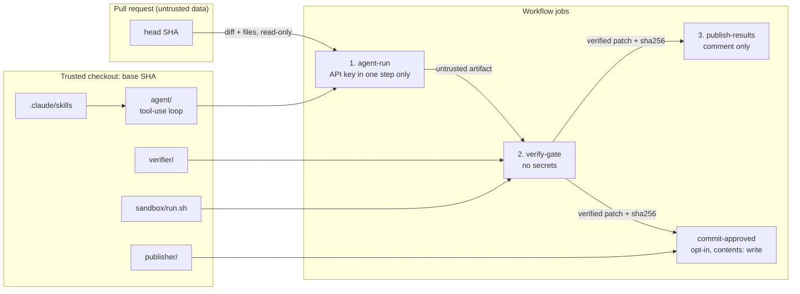

# Taskly with an AI unit-test agent

This repository adds a custom agent that analyzes a pull request, writes or
updates unit tests for the Taskly backend and frontend, and proves the tests
through a sandboxed verification gate before a human can commit them.

- Agent + skills: `.claude/agents/unit-test-agent.md`, `.claude/skills/`
- Runtime: `ai_test_agent/` (`agent`, `verifier`, `publisher`, `sandbox`,
  `selftests`)
- Workflows: `.github/workflows/unit-test-agent.yml` (PR) and
  `coverage-backfill.yml` (manual backfill)

**Provider note.** The default provider is DeepSeek
(`deepseek-flash` over its Anthropic-compatible Messages API) because that is
the path with recorded live runs. Anthropic (`claude-sonnet-5-5`) is fully
supported and selected with `TASKLY_AGENT_PROVIDER=anthropic` plus
`ANTHROPIC_API_KEY`, but no live run on it is recorded here.

## Architecture



## Decisions

| Decision | Rationale | Trade-off |
| --- | --- | --- |
| Custom tool-use loop on the official `anthropic` SDK | Every API call, tool call and token count is auditable; no framework hides the control flow | We own retries and message plumbing |
| Provider abstraction: DeepSeek by default, Anthropic opt-in | DeepSeek exposes an Anthropic-compatible Messages API, so the same SDK, tools and loop work unchanged; the key, base URL, default model and price table are selected in one place. The default is the provider with recorded live runs | A second price table to maintain, and DeepSeek peak rates are used for budgets |
| Direct SDK instead of LangGraph or similar | Fewer dependencies, clearer security boundary, nothing to keep in sync with the model API | No framework features (persistence, graph visualization) |
| All tooling runs from the trusted base checkout | The PR cannot change the code that holds the key or makes decisions | Tooling changes need their own PR before a demo PR |
| Patch posted by default, commit opt-in via label | The patch is reviewable and a human decides what lands | A second action is required to commit |
| Per-stack baseline and per-stack revert | A broken backend baseline must not block a healthy frontend | More sandbox runs per PR |
| Differential fail-on-base signal | Shows whether the new tests actually exercise changed behavior | It is evidence, not proof; new source files are `n/a` |
| Strict manifest schema + independent integrity rules | Model output is untrusted and the verifier does not share the agent's path logic | Some duplication between agent and verifier |
| Cost is computed from response usage | No estimates; cache reads/writes are priced separately | Prices must be updated when the model changes |
| Coverage backfill reuses the same gate | One definition of "verified" everywhere | Backfill is serial and slower |

## How to run

Prerequisites:

1. Repository secret `DEEPSEEK_API_KEY` (default provider) or
   `ANTHROPIC_API_KEY` with the repository variable
   `AGENT_PROVIDER=anthropic`.
2. Actions → General → Workflow permissions: read-only, and "Allow GitHub
   Actions to create and approve pull requests" enabled.
3. Label `ai-tests:commit`.

Pull request flow: open, push to, reopen or label a PR. Add
`ai-tests:commit` only after reviewing the sticky comment; the label event
does not re-run the agent.

Backfill: Actions → Coverage backfill → Run workflow, choose `stack` and
`max_batches`. It updates `chore/ai-backfill-unit-tests` and opens or updates
a PR against the default branch.

Local run (same gate):

```sh
cd ai_test_agent
python3 -m venv .venv
.venv/bin/pip install -r requirements.lock
export TASKLY_AGENT_PROVIDER=deepseek   # the default; use anthropic to opt in
export DEEPSEEK_API_KEY=...             # ANTHROPIC_API_KEY for Anthropic
.venv/bin/python -m agent --mode pr \
  --repo ../pr --diff ../pr.diff --out ../artifacts \
  --skills-dir ../.claude/skills \
  --agent-definition ../.claude/agents/unit-test-agent.md \
  --sandbox-script sandbox/run.sh
.venv/bin/python -m verifier --verify-only \
  --pr-dir ../pr --trusted-dir .. --base-sha "$(git rev-parse HEAD)" \
  --manifest ../artifacts/agent_manifest.json \
  --patch ../artifacts/candidate_tests.patch --out ../verified
```

## How the agent and skills load

`agent/definition.py` reads `.claude/agents/unit-test-agent.md`: the
frontmatter declares name, description, model key and allowed tools, the body
becomes the system prompt. `agent/skills.py` reads
`.claude/skills/*/SKILL.md`; only name and description are in the prompt until
the model calls `activate_skill`, which returns the body and records the
activation in the trace.

## Example run

**Demo PR #1** — [pull/11](https://github.com/CharlesSBL/taskly-app/pull/11),
workflow run
[39927537759](https://github.com/CharlesSBL/taskly-app/actions/runs/39927537759).
The PR adds a due-soon endpoint, a frontend predicate/badge and a docs note.

- 7 decisions: 2 `create` (`due.py`, `due.ts`), 4 `update` (router, API client,
  header, page), 1 `skip` (docs).
- Both stacks accepted. Coverage: backend 47.88% → 51.69% (+3.81), frontend
  49.00% → 51.57% (+2.57).
- Fail-on-base: the three updated test files failed on the base; the two new
  files are `n/a`.
- 20 turns, 12,459 input / 14,977 output tokens, **$0.0235** (DeepSeek flash,
  peak rates).
- The opt-in `ai-tests:commit` label produced commit
  [`a3a6240`](https://github.com/CharlesSBL/taskly-app/commit/a3a6240) after the
  labeler permission and patch sha256 were re-checked.

**Coverage backfill** — run
[39901769430](https://github.com/CharlesSBL/taskly-app/actions/runs/39901769430)
opened [pull/10](https://github.com/CharlesSBL/taskly-app/pull/10), merged as
`dda5cd3`. The agent wrote three tests (`test_health.py`, `AppProviders.test.tsx`,
`TodoEmptyState.test.tsx`); coverage moved 42.42% → 47.88% backend and
47.68% → 49.00% frontend. 18 turns, $0.0173.

**Nothing to test** — [pull/12](https://github.com/CharlesSBL/taskly-app/pull/12),
run
[39928204014](https://github.com/CharlesSBL/taskly-app/actions/runs/39928204014):
docs-only change, 0 turns, `$0.0000`, report state `nothing_to_test`.

The live runs also exposed four real defects that are fixed in `main`: test
paths passed to the sandbox were not stack-relative, the publisher resolved a
relative patch path after `git -C`, the verifier was suppressed by a skipped
job dependency, and DeepSeek occasionally truncated a response at the 4k token
cap. The fixes are the `fix(...)` and `ci:` commits around the backfill merge
in the history.

## Security checklist

| Control | How it is enforced |
| --- | --- |
| Trusted checkout for key-holding and gate code | Jobs 1–3 checkout the base SHA into `trusted/`; the head is a separate `pr/` tree |
| Least privilege | `permissions: {}` at workflow level; per-job read; commit job only has `contents: write` |
| API keys only in the agent step | `env:` on that single step; verifier/publisher jobs have no secrets; the provider key is read from config |
| `pull_request`, not `pull_request_target` | Workflow trigger; forks are skipped with a step summary |
| Untrusted diff/files and model output | `<untrusted_source_data>` wrapping, escaped closing tag, strict schemas, independent verifier allowlists |
| Lockfile changes | Dependencies always come from the base revision's lock files; the report warns when the PR changed them |
| Labeler authorization | `gh api .../collaborators/{login}/permission`; only `admin` or `write` |
| Same-repo only for commit | `head.repo.full_name == github.repository` |
| Action pinning | Every `uses:` is a 40-character SHA; `verifier.action_pins` fails the build otherwise |
| Dependabot | actions, pip (`/ai_test_agent`), npm (`/frontend`) |
| Sandbox | no network, read-only mounts, non-root, caps dropped, resource limits, tmpfs |
| Cost and loop control | `max_turns`, `max_files`, `max_diff_bytes`, `$0.75`/`$5.00` ceilings, concurrency per PR, bot guard, label events never re-run the agent |
| Fail on base | Worktree of the base SHA, per-file `true`/`false`/`n/a` |
| Patch integrity | sha256 re-checked twice (verifier output and publisher), allowlist and `git apply --numstat` agreement |
| No artifact code execution in the publisher | Publisher only reads the patch and report |
| Redaction | Trace writer redacts credentials recursively and truncates fields |
| Fail closed | Unknown model, malformed manifest, unreadable permission or bad sha all stop |

## Assumptions

- The base revision is a git checkout with the PR's base commit available.
- The repository uses `main` by default.
- Backend tests run with `cwd=backend`; frontend tests with `cwd=frontend`.
- The provider is `deepseek` by default and Anthropic is opt-in, so the
  provider with live-run evidence is the one a reviewer gets by default.
  Prices for both providers were verified on 2026-10-23; DeepSeek budgets use
  the higher peak-hour rates.
- The app's lock file is not hash-pinned, so the sandbox uses binary wheels
  only; the tooling's own lock file is hash-pinned.

## Limitations

Four limitations matter most:

1. **A push made with `GITHUB_TOKEN` does not trigger workflows.** The commit
   job pushes with `GITHUB_TOKEN`, so `ci.yml` does not run on that commit and
   required checks will not re-evaluate it. That is one reason the commit is
   opt-in and the patch is the default; the verified patch and its sha256 are
   already recorded in the sticky comment.
2. **A pull request can edit the workflow files.** The agent and the gate are
   read from the trusted base revision, but nothing stops a PR from changing
   `.github/workflows/`. Protecting those paths with CODEOWNERS or branch
   protection is a repository setting outside the workflow.
3. **Prompt injection cannot be eliminated.** Wrapping untrusted content,
   path allowlists, strict schemas and the independent gate reduce the impact;
   they do not make the model trustworthy.
4. **Fail-on-base is a heuristic.** A test can pass on both revisions and
   still be useful, and a test that fails on base may fail for an unrelated
   reason. It is evidence for a reviewer, not proof of regression sensitivity.

The rest:

- Forks are skipped; there is no fork execution path.
- Model output is non-deterministic; the gate is the stable contract.
- DeepSeek prices differ between peak and off-peak hours; costs are estimated
  at peak rates, so the reported figure is an upper bound outside peak hours.
- Backfill selects at most `3 × max_batches` modules in one agent run with a
  single $5 ceiling, rather than several independent runs. With nine targets
  the 30-turn budget ran out before `finish` and the run was rejected; the
  turn budget was raised to 45 and batches were kept to six targets.
- Backfill cannot create tests for code it cannot exercise: files that need a
  database, a browser environment or a real network are skipped, and the agent
  has no way to add dependencies. This is where per-stack coverage plateaus;
  see "Example run" for the measured ceiling.
- Diff coverage is not computed.
- The TypeScript quality checks are lexical heuristics, not a full parser.
- Coverage deltas depend on the full suite, so pre-existing flaky app tests can
  affect them.

## What was cut, in order

1. Diff-coverage (not implemented).
2. Multiple backfill runs with a hard cumulative ceiling (single run instead).
3. Extra comment states beyond the six implemented.
4. Fail-on-base polish (no automatic flip of a test's status into a revert).

Flakiness rerun is implemented: the accepted tests run twice and a second-run
failure reverts the stack.

## Production changes

- A GitHub App instead of `GITHUB_TOKEN`, so commits can trigger workflows.
- Ephemeral runners or gVisor/Firecracker for stronger isolation.
- Real mutation testing instead of the AST heuristics.
- A cost dashboard and per-repository budgets.
- A golden-PR evaluation suite to measure the agent before changing prompts.
- Org policy and required CODEOWNERS reviews on tooling paths.

## Suppressions

- None in `agent/`, `verifier/`, `publisher/` (no `# noqa`, `# nosec` or
  `eslint-disable`).
- `ai_test_agent/sandbox/Dockerfile`: `# hadolint ignore=DL3013` — pip
  versions come from the application's trusted requirements file.
- Test fixtures that intentionally contain fake credentials are marked
  `# pragma: allowlist secret` so the secret scanner does not flag them.
- `frontend/coverage/**` contains generated files with `eslint-disable`; the
  directory is git-ignored.

## Local verification performed

The full pipeline was exercised end to end on a scratch clone with a
hand-written candidate test (not agent output): verifier accepted the backend
stack, the differential check reported `passed on both`, and the publisher
rendered the comment from the real report. That scratch run is only a smoke
test; every number in "Example run" comes from the workflow runs linked there.

## Regression tests for the defects the live runs exposed

| Defect | Test |
| --- | --- |
| Sandbox received `backend/...` although it runs with `cwd=backend` | `selftests/test_tools.py::test_run_tools_pass_stack_relative_paths_to_the_sandbox` |
| The agent could not run a test directory, so it verified single files | `selftests/test_tools.py::test_run_tools_accept_a_test_directory` |
| A wrong first draft could not be rewritten in the same run | `selftests/test_tools.py::test_write_can_rewrite_the_same_file_without_charging_the_budget` |
| A backend line longer than the gate's 100-character limit | `selftests/test_tools.py::test_write_rejects_a_backend_line_longer_than_the_lint_limit` |
| Publisher resolved a relative patch path after `git -C` | `selftests/test_commit.py::test_relative_patch_path_is_resolved_before_git` |
| Truncated provider response was indistinguishable from a normal stop | `selftests/test_loop.py::test_truncated_response_is_reported_and_uses_the_configured_cap` |
| A skipped job suppressed the verification gate | `selftests/test_workflows.py::test_verifier_always_runs_after_the_agent_job` |
| Artifact download nested the patch under an extra directory | `selftests/test_workflows.py::test_artifact_downloads_are_not_nested_under_a_path` |
